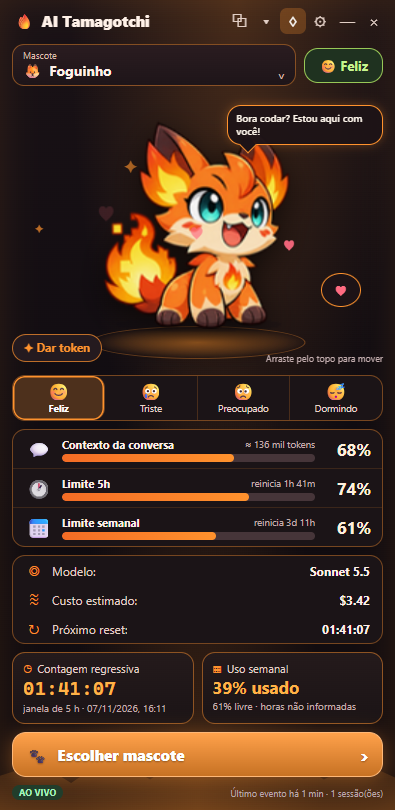

# 🔥 AI Tamagotchi

**Um mascote animado para o seu desktop que reage ao uso do Claude Code.** Ele fica numa janela pequena (ou grudado ao lado do terminal) e mostra, com carinha e animação, quanto você ainda tem de contexto, de janela de 5 horas e de limite semanal. É gratuito, de código aberto e **não depende de navegador**.

[](LICENSE)


<p align="center"></p>

> Projeto independente da comunidade. **Não é afiliado à Anthropic.** "Claude" e "Claude Code" são marcas da Anthropic.

## O que ele faz
- 😊😢😟😴 **Humor pelo uso real:** feliz (>50% livre), triste (30–50%), preocupado (1–29%) e **dormindo** quando a quota esgota; ☀ **acorda** quando ela renova.
- 📊 **Medidores** de contexto, janela de 5 h e limite de 7 dias, com contagem regressiva até o reset (só quando o Claude Code informa o horário).
- 🦊 **18 mascotes** com paleta própria e animação quadro a quadro. Escolha na galeria.
- 🪟 **Janela de desktop:** sem borda, arrastável, redimensionável, sempre à frente (opcional) e **sem barra de rolagem**.
- ⧉ **Gruda ao terminal** (Windows Terminal, CMD ou PowerShell), acompanha ao mover/redimensionar e desgruda quando você arrasta o mascote.
- 🔒 **Privado por padrão:** só o necessário, tudo local, nada vai para a internet. Veja [Privacidade](#privacidade).

<p align="center"></p>

## Instalação (para quem só quer usar)

**Requisitos:** Windows 10 ou 11 (64 bits) e o [Claude Code](https://claude.com/claude-code) instalado e em uso. Os limites de 5 h e 7 dias só existem em planos Pro/Max.

1. **Baixe o instalador:** abra a página de [**Releases**](https://github.com/GabrielMouraKT/ai-tamagotchi/releases/latest) e baixe `AI-Tamagotchi-Setup-<versão>.exe`.
2. **Execute o arquivo.** Instala só para o seu usuário (não pede administrador), cria atalhos e abre o mascote. Nenhum terminal aparece.
   - O Windows pode mostrar **"O Windows protegeu seu computador"**. O instalador ainda **não é assinado digitalmente** (isso exige um certificado pago). Clique em **Mais informações → Executar assim mesmo**. Se preferir, confira o código-fonte neste repositório e o passo a passo de [compilar você mesmo](#rodar-pelo-código-desenvolvedores).
3. **Conecte ao Claude Code (uma vez só):** no mascote, clique em **⚙ → Conectar ao Claude Code → Conectar**. Isso adiciona somente a chave `statusLine` ao arquivo de configurações do Claude Code (`~/.claude/settings.json`), **depois de fazer um backup**, e **não substitui** uma linha de status que você já use.
4. **Abra uma nova sessão do Claude Code.** Em poucos segundos o painel passa a mostrar **AO VIVO** e os seus números reais. Até conectar, ele mostra "Indisponível" — nunca valores inventados.

Para **desinstalar**: Configurações do Windows → Aplicativos → AI Tamagotchi. Para **desconectar** do Claude Code sem desinstalar: ⚙ → Conectar → **Desconectar**.

## Como usar
| Botão | O que faz |
|---|---|
| **⧉** | Gruda / desgruda do terminal |
| **▾** | Escolhe a qual terminal grudar (quando há vários) |
| **♢** | Sempre à frente |
| **⚙** | Menu: sessões, modelo, custo, tokens, resets, conexão, privacidade, preferências |
| **— / ×** | Minimizar / fechar |
| Cards de contexto, 5 h, 7 dias, modelo, custo | Clique para ver os detalhes |
| **Abas Feliz / Triste / Preocupado / Dormindo** | Mostram uma **prévia** da animação por 6 s (não alteram números) |
| **✦ Dar token** | Só uma animação divertida; **não consome nada** da sua conta |
| **Escolher mascote** | Abre a galeria (18 personagens) |

**Grudar ao terminal:** com um terminal aberto, clique em ⧉. O mascote fica **preso àquele terminal** (mesmo se o foco for para outra janela) e o acompanha ao mover ou redimensionar; vai para a esquerda se faltar espaço à direita. **Arrastar só o mascote desgruda.** Se o terminal fechar, ele fica parado. Com vários terminais, escolha pelo ▾. Funciona com **Windows Terminal** e **CMD/PowerShell clássico** (o terminal integrado do VS Code não é uma janela separada e não é detectado).

## O que cada número significa
- **Contexto:** espaço livre da conversa. Chegar a 0% **não é limite de quota**: use `/compact` ou comece outra conversa. O mascote fica preocupado, mas **nunca dorme só por isso**.
- **5 h / 7 dias:** quota da sua conta, informada pelo Claude Code (só Pro/Max, e só depois da primeira resposta de cada sessão). Sem dado, aparece **Indisponível**.
- **Contagem regressiva:** só aparece se o Claude Code informar o horário de reset. Nunca é estimada.
- **Custo:** é uma **estimativa** calculada pelo Claude Code a preço de lista da API. **Não** é fatura nem cobrança extra da sua assinatura.

## Conectar manualmente (alternativa)
O botão "Conectar" faz isto por você. Se preferir, adicione ao `~/.claude/settings.json` (preserve as outras chaves):

```json
"statusLine": { "type": "command", "command": "node \"C:/caminho/para/ai-tamagotchi/statusline.js\"" }
```
Ou use o script, que faz backup e recusa sobrescrever uma statusLine existente: `node install-statusline.js` (opções `--dry-run`, `--force`, `--remove`). Use barras normais (`/`) no caminho: o Claude Code usa o Git Bash no Windows.

## Solução de problemas
| Sintoma | O que fazer |
|---|---|
| Mostra **SEM SESSÃO** / "Indisponível" | Conecte (⚙ → Conectar) e abra uma **nova** sessão do Claude Code. A linha de status só roda em sessões iniciadas depois de conectar. |
| 5 h / 7 dias "Indisponível", mas o resto funciona | Seu plano/sessão não informa limites (só Pro/Max) ou ainda não houve a primeira resposta. É esperado. |
| Aviso do Windows ao abrir o instalador | Instalador sem assinatura digital. **Mais informações → Executar assim mesmo.** |
| ⧉ não gruda | Só funciona com Windows Terminal e CMD/PowerShell clássico, em janela própria e não minimizada. Veja se aparece no ▾. |
| "Já existe outra linha de status" | O app não sobrescreve a sua. Combine os comandos manualmente ou use `--force` no script (o backup guarda a anterior). |
| Antivírus reclama | Arquivos novos e não assinados às vezes geram falso positivo. O código é aberto; você pode [compilar](#rodar-pelo-código-desenvolvedores) por conta própria. |
| Quero apagar os dados | Apague a pasta `.claude/ai-tamagotchi` do seu usuário e `%APPDATA%\ai-tamagotchi`. |

## Privacidade
O app usa **somente o necessário para o mascote funcionar**.
- **Usa (só neste computador):** do Claude Code — modelo, % de contexto, % e horário de reset das janelas (quando informados), custo estimado e o identificador da sessão. Das janelas de terminal — posição, tamanho e título, só para grudar ao lado (**não são salvos nem enviados**). Suas escolhas (mascote, posição da janela).
- **Não faz:** não lê conversas, comandos, código, arquivos, senhas, tokens nem a conta do Claude; **não pede login**; não lê o conteúdo do terminal; **não envia nada pela internet** (sem telemetria, cadastro ou anúncios). O painel só conversa com o próprio app em `127.0.0.1`.
- **Onde ficam os dados:** `~/.claude/ai-tamagotchi/sessions/*.json` (arquivos pequenos).

Isso está na tela **⚙ → Privacidade** e é garantido por testes automáticos ([`test/privacy.test.js`](test/privacy.test.js)): nenhum endereço externo no código, nada de credenciais, e só campos de telemetria são gravados.

## Rodar pelo código (desenvolvedores)
Requisitos: [Node.js](https://nodejs.org) 20+ (testado com 22/24) e Git.

```powershell
git clone https://github.com/GabrielMouraKT/ai-tamagotchi.git
cd ai-tamagotchi
npm install          # instala o Electron e o electron-builder (devDependencies)
npm run desktop      # abre a janela (abre um terminal; use Iniciar-AI-Tamagotchi.vbs para abrir sem terminal)
npm test             # roda os testes
npm run dist         # gera o instalador em dist/AI-Tamagotchi-Setup-<versão>.exe
```
Para ver só o painel no navegador, durante o desenvolvimento: `node server.js` e abra `http://127.0.0.1:43771`.

Mais detalhes em [`docs/ARQUITETURA.md`](docs/ARQUITETURA.md).

## Contribuir 💛
Contribuições são muito bem-vindas: correções, novos mascotes, traduções, testes, ideias. Leia o [**guia de contribuição**](CONTRIBUTING.md), abra uma [issue](https://github.com/GabrielMouraKT/ai-tamagotchi/issues/new/choose) ou envie um pull request. Este projeto segue um [código de conduta](CODE_OF_CONDUCT.md).

## Licença
[MIT](LICENSE). O código **e a arte dos mascotes** (gerada por IA) podem ser usados, modificados e redistribuídos por qualquer pessoa, inclusive comercialmente. Veja também o [NOTICE](NOTICE.md).
